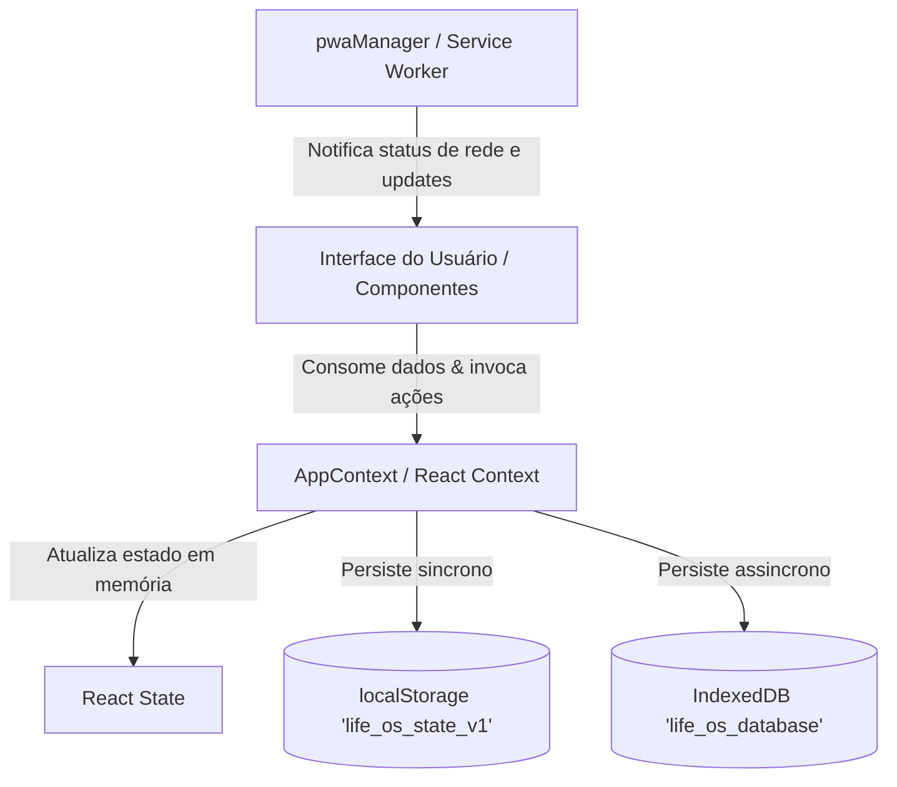

# Arquitetura do Sistema — Life OS

> Documentação técnica da estrutura arquitetural, separação de responsabilidades, fluxo de dados e comunicação de componentes do Life OS.

---

## 1. Visão Geral da Arquitetura

O **Life OS** segue a arquitetura de **Single Page Application (SPA) reativa**, orientada a componentes React funcionais, com estado global compartilhado via React Context e camada de persistência híbrida desacoplada.



---

## 2. Estrutura de Diretórios e Módulos

```
src/
├── App.tsx                  # Ponto de entrada do componente raiz; envolve AppContent com AppProvider
├── AppContent.tsx           # Roteador visual de topo, layout responsivo e controle de header/modais
├── main.tsx                 # Bootstrapping do React 19 no DOM e registro do Service Worker
├── index.css                # Estilos globais Tailwind, variáveis CSS de cores e microinterações
├── components/              # Componentes compartilhados e globais
│   ├── Navigation.tsx       # Navegação responsiva (Sidebar no desktop, Bottom Bar no mobile)
│   ├── SettingsModal.tsx    # Modal de ajustes, gerenciamento de backup JSON e alternância de tema
│   ├── QuickAddModal.tsx    # Modal legado de captura multifuncional (tarefa/evento/hábito)
│   ├── GlobalSearchModal.tsx# Modal legado de busca global
│   ├── Sidebar.tsx          # Componente auxiliar de navegação lateral
│   └── SimpleNav.tsx        # Variação simplificada de barra de navegação
├── context/
│   └── AppContext.tsx       # Estado global, despachadores de ações e sincronização com storage
├── features/                # Módulos verticais de domínio
│   ├── calendar/            # ScheduleView.tsx (visão moderna por Dia/Semana/Mês) e CalendarView legado
│   ├── dashboard/           # TodayView.tsx (visão diária consolidada) e TodayDashboard legado
│   ├── habits/              # Hábitos (módulo isolado de histórico e criação)
│   ├── journal/             # SimpleJournalView.tsx (editor de diário com auto-save) e JournalView
│   ├── planner/             # Planejador temporal e time-blocking semanal
│   ├── projects/            # Gerenciamento de projetos e metas
│   ├── reviews/             # Telas de revisão diária e semanal
│   ├── settings/            # Telas auxiliares de configurações
│   └── tasks/               # Componentes granulares de tarefas (TaskItem, TaskModal)
├── lib/                     # Utilitários puros sem acoplamento a UI
│   ├── dateUtils.ts         # Formatação de datas em pt-BR, cálculo de semanas, chaves YYYY-MM-DD
│   ├── planner.ts           # Algoritmos de conversão entre horários, minutos e agendamento
│   └── pwaManager.ts        # Singleton de gerenciamento de Service Worker e eventos PWA
├── storage/                 # Camada de persistência e integridade de dados
│   ├── indexedDBAdapter.ts  # Adaptador Promisified para IndexedDB local
│   ├── initialData.ts       # Dados padrão de exemplo e template de estado limpo
│   └── storageService.ts    # Serviço híbrido (localStorage + IndexedDB), validação e import/export
├── test/                    # Configuração e testes automatizados
│   ├── dateUtils.test.ts    # Testes unitários de manipulação de datas
│   ├── planner.test.ts      # Testes unitários da lógica de blocos de tempo
│   ├── storage.test.ts      # Testes de sanitização, importação e persistência
│   └── setup.ts             # Setup do Vitest com jest-dom
└── types/
    └── index.ts             # Definição canônica de todas as interfaces e modelos de dados
```

---

## 3. Responsabilidade de Cada Camada

### A. Camada de Apresentação (`src/components/`, `src/features/`, `AppContent.tsx`)
- Renderiza componentes controlados ou não-controlados com Tailwind CSS.
- **Roteamento por Estado:** Não utiliza roteador baseado em URL (`react-router`), assegurando compatibilidade estrita com hospedagem em subdiretórios no GitHub Pages sem erros 404 em refresh. O controle é feito via string `currentView` ('today', 'schedule', 'journal').
- Responsividade: Layout adaptável onde o desktop exibe uma barra lateral fixa à esquerda (`Navigation.tsx`) e o mobile exibe cabeçalho superior discreto e barra de abas inferior na zona de alcance do polegar.

### B. Camada de Domínio e Estado (`src/context/AppContext.tsx`)
- O `AppContext` expõe o estado consolidado (`AppStateData`) e um conjunto de funções puras ou de mutação imutável:
  - Tarefas: `addTask`, `updateTask`, `deleteTask`, `duplicateTask`, `toggleTaskStatus`.
  - Cronograma: `addEvent`, `updateEvent`, `deleteEvent`, `deleteEventSeries`, `toggleEventCompleted`, `associateTaskToCalendar`.
  - Diário: `addJournalEntry`, `updateJournalEntry`, `deleteJournalEntry`.
  - Preferências e backups: `updatePreferences`, `toggleTheme`, `exportDataJSON`, `importDataJSON`, `resetAllData`.
- Gerencia o status de salvamento visual (`saveStatus`: `'idle' | 'saving' | 'saved' | 'error'`) e a hora da última gravação.

### C. Camada de Persistência Híbrida (`src/storage/`)
- Desacoplada da interface visual.
- **Síncrona Imediata:** Lê e grava no `localStorage` sob a chave `life_os_state_v1` a cada alteração de estado para garantir renderização instantânea ao recarregar.
- **Assíncrona Robusta:** Reenfileira gravações no `IndexedDB` (`life_os_database`) sob o registro `root_state`, garantindo resiliência contra limites de cota do `localStorage`.
- **Validação e Sanitização:** A função `validateAppStateData` inspeciona cada campo importado ou carregado, atribuindo defaults para campos ausentes e descartando registros corrompidos sem derrubar a aplicação.

---

## 4. Comunicação entre Componentes e Fluxo de Dados

1. **Ação do Usuário:** O usuário cria um evento, move uma tarefa ou edita uma anotação.
2. **Invocação do Dispatcher:** O componente chama a respectiva função do hook `useApp()` (ex: `addEvent(dados)`).
3. **Atualização de Estado:** O `AppContext` atualiza o estado React via `setState` de forma imutável.
4. **Persistência Imediata:** O `AppContext` aciona `storageService.save(novoEstado)`, salvando no `localStorage` de forma síncrona e disparando gravação no `IndexedDB`.
5. **Re-renderização:** Todos os componentes inscritos nos dados modificados re-renderizam instantaneamente com microanimações e feedback visual.
